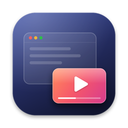
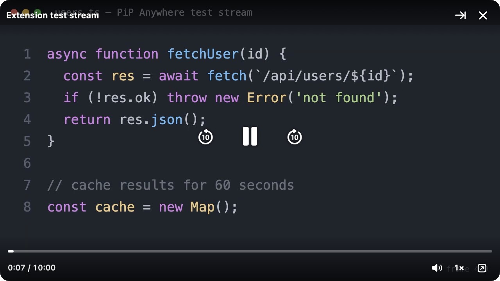
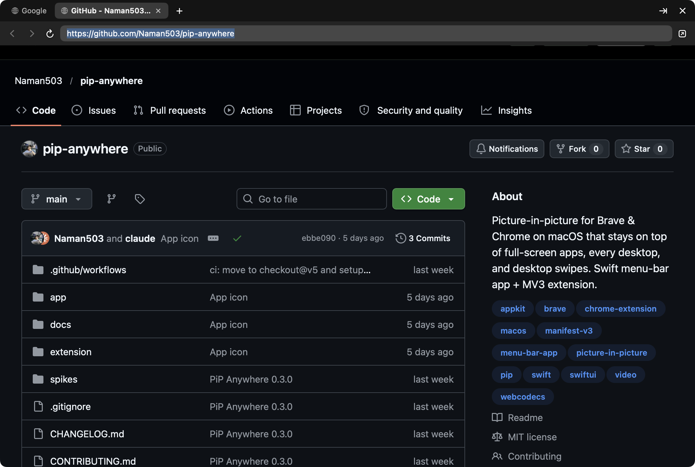
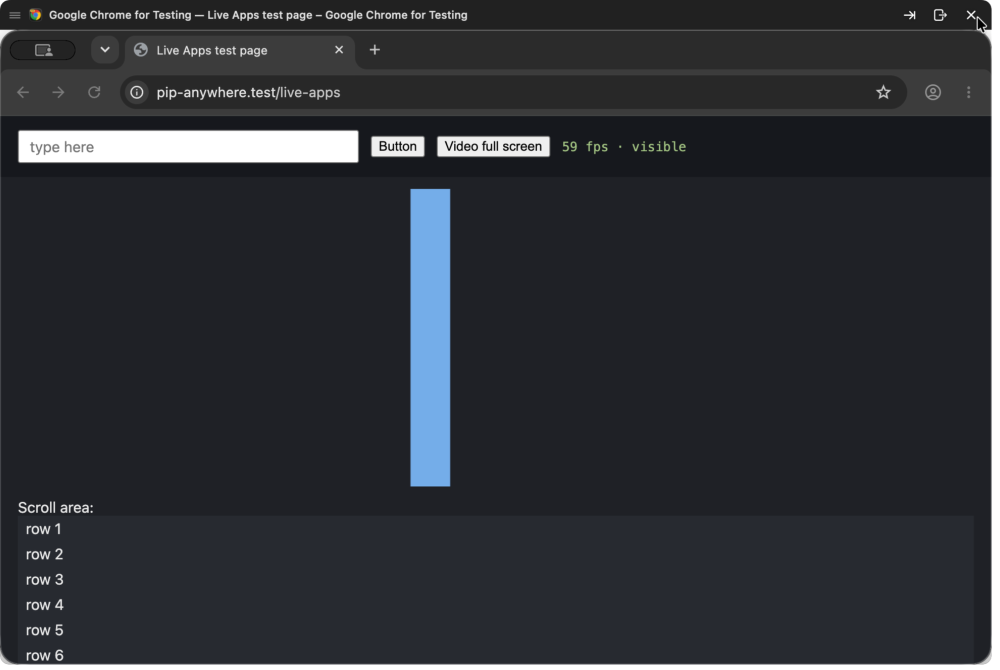
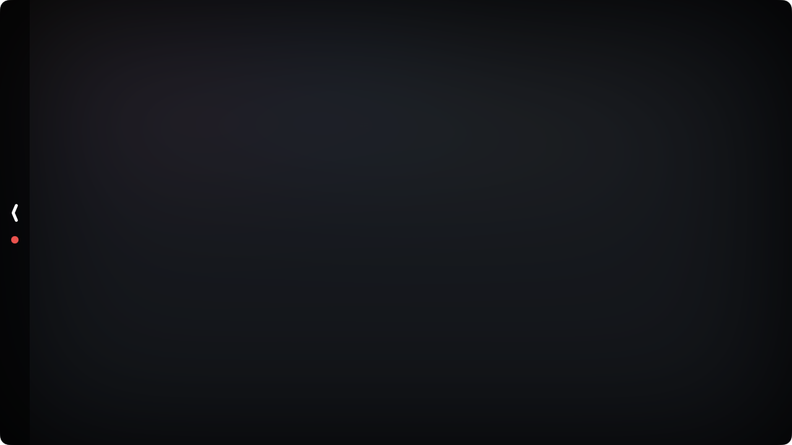
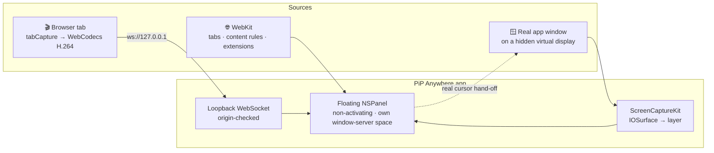

<div align="center">



# PiP Anywhere

**A floating window for your Mac that stays on top of _everything_ (other desktops, full-screen apps, even mid-swipe) and can hold a video, a whole browser, or any app.**

[](https://github.com/Naman503/pip-anywhere/actions/workflows/ci.yml)
[](https://github.com/Naman503/pip-anywhere/releases)


[](LICENSE)



</div>

---

## Why

Brave's and Chrome's picture-in-picture **disappears as soon as you switch to an app in full-screen mode**. macOS doesn't layer an ordinary app's window over another app's full-screen Space. The bug has been open since 2020, and no browser setting fixes it.

PiP Anywhere owns its floating window, so it can do what the browser's can't:

- 🖥️ **Over full-screen apps.** Visible over Xcode, Keynote, a full-screen browser, anything.
- 🧭 **On every desktop.** It doesn't even move while you swipe between desktops with four fingers.
- 🎯 **Never steals focus.** The app you're working in stays in front.

## Three ways to use it

| | 🎬 **Video** | 🌐 **Floating browser** | 🪟 **Live Apps** (beta) |
|---|---|---|---|
| **What floats** | The video from any tab in Brave or Chrome | A full browser with tabs, built in | Any real app window: your Brave, Slack, Terminal… |
| **Start it** | `⌥⇧P` in the browser | `⌃⌥N` | `⌃⌥⇧N` (new Brave window) or `⌃⌥F` (the app you're in) |
| **Interaction** | Playback controls | Everything: it's a browser | Everything: real clicks and typing |
| **Ad blocking** | Your browser's | ✅ EasyList + EasyPrivacy, YouTube ad skipping | Your browser's (Brave Shields etc.) |
| **Extensions** | Your browser's | ✅ Unpacked web extensions (macOS 15.4+) | Your browser's |
| **Permissions** | None | **None** | Screen Recording + Accessibility |
| **Engine** | Tab capture → H.264 | WebKit (Safari's engine) | Hidden virtual display + ScreenCaptureKit |

### 🎬 Video picture-in-picture

Pop the video out of any tab; sound keeps playing from the tab.

- **Up to 60 fps,** hardware-encoded and hardware-decoded H.264.
- **Controls:** play/pause, ±10 s, seek bar, volume and mute, and speed from 0.75× to 3× (including 2.85×).
- **Scroll over the video** up/down for volume, sideways to seek.
- **Back to the tab** with one click.

### 🌐 Floating browser



A real browser that lives entirely inside the floating window. Pages resize with it, clicks and typing go straight in, and it needs no permissions.

- **Browsing:** tabs, an address bar (a URL or a search), back/forward/reload, and zoom.
- **Remembers you:** logins are kept, and tabs come back the next time you open it.
- **Downloads** go to `~/Downloads`.
- **Built-in ad and tracker blocking.**
  - EasyList and EasyPrivacy are converted into WebKit's native blocking rules: about 111,000 network rules and 10,000 element-hiding rules. Blocking happens inside WebKit, before a request is even made.
  - **YouTube ad skipping.** Filter lists can't block YouTube's own ads, so they're skipped in the page.
  - Toggle it in the menu.
- **Web extensions.** Put an unpacked extension (a folder with a `manifest.json`) into **menu → Extensions…** and it loads with the permissions it asks for.
  - Tested with [BetterTube](#acknowledgements). Content scripts, `declarativeNetRequest` and storage work.
  - Requires macOS 15.4+.
- **Open Brave's / Chrome's / Safari's current tab here** from the menu, or send a page back with ↗.
- **Shortcuts:** `⌘T` `⌘W` `⌘L` `⌘R` `⌘[` `⌘]` `⌘+` `⌘-` `⌘0` `⌃Tab`, plus copy, paste and undo.

### 🪟 Live Apps (beta)



Your **real** apps, live and fully usable in the floating window. For example, Brave with your profile, extensions and Shields.

- **`⌃⌥⇧N`** opens a **new Brave window** just for floating. Closing the float (or the window's last tab) closes that window.
- **`⌃⌥F`** adopts the window you're in. When you stop floating, it goes back exactly where it was, back into full screen too if it was.
- **Real input.** Point at the floating window and your real cursor is handed to the app, so clicks, typing, scrolling, right-click and drag-and-drop are genuine. Move out and the cursor (and keyboard focus) comes back.
- **The app thinks the floating window is its screen.** Resize the window and the app re-lays out at that size, so text stays sharp. When a video goes full screen, it fills the floating window instead of a display.
- **Light on battery.**
  - Frames go straight from ScreenCaptureKit to the screen: no encoding and no copying.
  - Unchanged frames cost nothing.
  - Capture drops to about 1 fps while slid away.

## The floating window

Everything below works in every mode.

<p align="center">
  <br>
  <sub>Slid into the edge: the visible strip is blurred so nobody can see what's on it.</sub>
</p>

- **Slide to the edge.** Flick it past the edge or press `⌃⌥P`. Only a thin tab stays, and it's heavily blurred. Click it, and the window comes back to exactly where it was.
- **Place it anywhere,** even half off the side. Corner snapping is optional. It can never get lost on the hidden Live Apps display.
- **Resize** from any edge or corner (the pointer shows where), pinch, `⌃⌥=` / `⌃⌥-`, size presets, or double-click.
- **Ghost mode** (`⌃⌥G`) makes it see-through and lets clicks pass through. Opacity is adjustable, and you can **hide it from screen sharing**.
- **Global shortcuts** work from any app, including full-screen ones.

## How it works



<details>
<summary><b>The details</b></summary>

- **Over full screen.** A non-activating `NSPanel` with `.canJoinAllSpaces` + `.fullScreenAuxiliary`, from an accessory (menu-bar) app. This combination is what lets it show over other apps' full-screen Spaces.
- **Still during swipes.** The panel lives in its own window-server space (private SkyLight calls, the same technique as SketchyBar's "sticky" mode).
- **Video.** The extension captures the tab (video only, so the tab keeps its sound), crops each frame to the `<video>`, and encodes H.264 with WebCodecs. Frames go to the app over a WebSocket bound to `127.0.0.1` that accepts only the extension's pinned ID. `AVSampleBufferDisplayLayer` decodes them in hardware.
- **Floating browser.** `WKWebView` tabs share one persistent data store. Ad blocking is `WKContentRuleList`s compiled from EasyList/EasyPrivacy by a tested converter (`PiPCore.ContentBlocker`). Extensions load through `WKWebExtensionController`.
- **Live Apps.** A virtual display (private `CGVirtualDisplay`, like DeskPad and BetterDisplay) is the app's "stage": nothing covers the app there, so it never stops rendering.
  - The window is moved there with the Accessibility API.
  - ScreenCaptureKit captures it, and each frame's IOSurface becomes the panel layer's contents.
  - Input is your real cursor, warped onto the stage while you point at the panel.
  - In full screen, the stage itself is resized to the floating window.
- **Private APIs** are loaded at runtime and degrade gracefully if a future macOS removes them.

Design notes, measurements and experiments: [`docs/`](docs).
</details>

## Install

**Requirements:** macOS 14 Sonoma or later (tested on macOS 26 Tahoe). The video mode also needs Brave or Chrome 116+. Building needs Xcode 16+ and Node.js 20+.

### 1. The app

```bash
git clone https://github.com/Naman503/pip-anywhere.git
cd pip-anywhere/app
scripts/bundle.sh
cp -R "build/PiP Anywhere.app" /Applications/
open "/Applications/PiP Anywhere.app"
```

A **PiP** icon appears in the menu bar. Turn on **menu → Open at login** to have it always ready.

> **Prebuilt copy?** Downloads on [Releases](https://github.com/Naman503/pip-anywhere/releases) aren't notarized. The first time, right-click the app and choose **Open**, or run `xattr -dr com.apple.quarantine "/Applications/PiP Anywhere.app"`.
>
> **Building yourself and using Live Apps?** Sign with a stable identity so macOS remembers the permissions across rebuilds: `SIGN_IDENTITY="Apple Development: you@example.com (TEAMID)" scripts/bundle.sh`.

### 2. The extension (video mode only)

```bash
cd ../extension && npm install && npm run build
```

1. Open `brave://extensions` (or `chrome://extensions`) and turn on **Developer mode**.
2. Click **Load unpacked** and choose `extension/dist`.
3. Pin **PiP Anywhere** to the toolbar.

### Permissions

| Mode | Needs | Why |
|---|---|---|
| Video | Nothing | The extension streams to the app on `127.0.0.1` |
| Floating browser | Nothing | The pages are drawn by the app itself |
| Live Apps | **Screen Recording** | To show another app's window live (nothing is recorded or saved) |
| Live Apps | **Accessibility** | To move the app's window to the hidden display and hand it your cursor |

macOS only applies a new Screen Recording grant after the app restarts. PiP Anywhere tells you when that's needed.

## Keyboard shortcuts

| Video | | Floating browser | | Live Apps | |
|---|---|---|---|---|---|
| Pop out (in the browser) | `⌥⇧P` | Open / close | `⌃⌥N` | Float a new Brave window | `⌃⌥⇧N` |
| Play / pause | `⌃⌥Space` | New / close tab | `⌘T` `⌘W` | Float the app I'm in | `⌃⌥F` |
| Back / forward 10 s | `⌃⌥←` `⌃⌥→` | Address bar | `⌘L` | Release the cursor | `⌃⌥E` |
| Mute | `⌃⌥M` | Back / forward / reload | `⌘[` `⌘]` `⌘R` | | |
| Back to the tab | `⌃⌥B` | Zoom | `⌘+` `⌘-` `⌘0` | | |

**Any mode:**
- slide to edge / bring back: `⌃⌥P`
- bigger / smaller: `⌃⌥=` `⌃⌥-`
- ghost mode: `⌃⌥G`

<details>
<summary><b>Automation (Shortcuts, Raycast, scripts)</b></summary>

The app listens for the distributed notification `local.pipanywhere.command`:

```bash
swift spikes/send-command.swift toggle
swift spikes/send-command.swift window:stash
swift spikes/send-command.swift browser:open:https://example.com
swift spikes/send-command.swift live:newwindow
```

**Playback:**
- `play`, `pause`, `toggle`
- `seek:<s>`, `seekTo:<s>`, `rate:<x>`, `volume:<0–1>`, `mute:<0|1>`
- `focusTab`, `close`

**Window:**
- `window:stash` · `window:unstash`
- `window:show` · `window:hide`
- `window:ghost` · `window:grow` · `window:shrink` · `window:zoom`
- `window:width:<pt>` · `window:corner:<name>` · `window:moveto:<x>,<y>`

**Floating browser:**
- `browser:open[:<url>]` · `browser:close`

**Live Apps:**
- `live:newwindow` · `live:float[:<app|pid|bundle id>]` · `live:unfloat`
- `live:release` · `live:diagnose` · `live:status`

**Debugging:**
- `snapshot:<file.png>`

</details>

## Limitations

- **DRM video** (Netflix, Prime Video, Disney+) can't be captured in Video or Live Apps mode. The floating browser plays what Safari can.
- **Video mode:** the video must stay in its tab's visible area. Switching tabs or desktops, or minimizing the browser, is fine.
- **Floating browser:** it's WebKit, not your Brave profile. You sign in to sites once. Extension toolbar popups don't have a place in the window yet.
- **Live Apps:** beta.
  - The hidden display shows up in System Settings → Displays while something floats.
  - It needs Screen Recording and Accessibility.
- **Private macOS APIs.** These power "stay still while switching desktops", the background resize cursor, and Live Apps' virtual display. They're loaded at runtime; if one disappears in a future macOS, that feature turns off and the rest keeps working.

## Development

```
app/                    macOS app (SwiftPM, no dependencies)
  Sources/PiPCore/        protocol, window geometry, ad-block converter — pure logic, unit-tested
  Sources/CVirtualDisplay/  Objective-C wrapper for the virtual display (resolved at runtime)
  Sources/PiPAnywhere/    panel, video, Browser/ (WebKit, ad blocking, extensions), Live/ (stage, capture, cursor)
extension/              Chromium MV3 extension (TypeScript + esbuild)
spikes/                 window-server probes, the Live Apps test harness, the command sender
docs/                   decisions & measurements, wire protocol, research, plans
```

| Command | Where | What it does |
|---|---|---|
| `swift test` | `app/` | 22 unit tests: protocol, geometry, resize zones, ad-block conversion |
| `scripts/bundle.sh [debug]` | `app/` | Builds `build/PiP Anywhere.app` (`SIGN_IDENTITY` optional) |
| `scripts/make-icon.sh` | `app/` | Regenerates every icon from code |
| `npm run typecheck` · `build` · `dev` | `extension/` | Type-check, bundle, rebuild on save |
| `node tests/e2e.mjs pipeline` · `youtube` | `extension/` | End-to-end with the real app: frame rate, commands, capture while minimized |
| `node spikes/live/harness.mjs` | root | Test browser for Live Apps: frame rate, visibility, input, full screen |
| `swift spikes/FullscreenProbe.swift` · `SpaceSwitchProbe.swift` | root | Window over full screen / still during desktop switches |

Test copies run on their own port (`--port 47898`) with their own settings, so the copy you use isn't disturbed. See [CONTRIBUTING.md](CONTRIBUTING.md).

## Documentation

- [Design decisions, measurements and every feedback round](docs/decisions.md)
- [Live Apps: plan](docs/live-apps/plan.md) · [technical research](docs/live-apps/research-technical.md) · [product research](docs/live-apps/research-product.md)
- [Extension ↔ app wire protocol](docs/protocol.md)
- [Original plan](docs/plan.md) · [background research](docs/research.md)
- [Changelog](CHANGELOG.md)

## Roadmap

- Extension toolbar buttons and popups in the floating browser
- Several floating windows at once; per-app size, position and opacity presets
- Zoom into part of a window, for reading small code in tutorials
- Launching the app from the browser (native messaging)
- Signed and notarized releases

## Acknowledgements

- [SketchyBar](https://github.com/FelixKratz/SketchyBar): the window-server "sticky space" technique.
- [DeskPad](https://github.com/Stengo/DeskPad): showing a virtual display in a window.
- [EasyList](https://easylist.to): the filter lists behind the built-in ad blocker.
- BetterTube: a companion YouTube extension, used to test web-extension support.
- Apple Developer Technical Support's forum guidance on panels over full-screen Spaces.

## License

[MIT](LICENSE) © 2026 Naman Pathak
